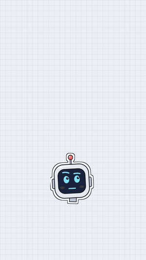
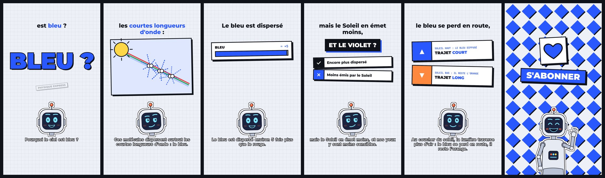
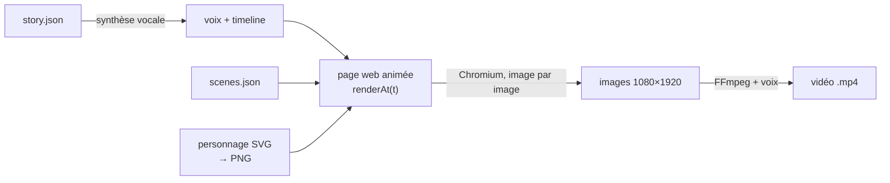
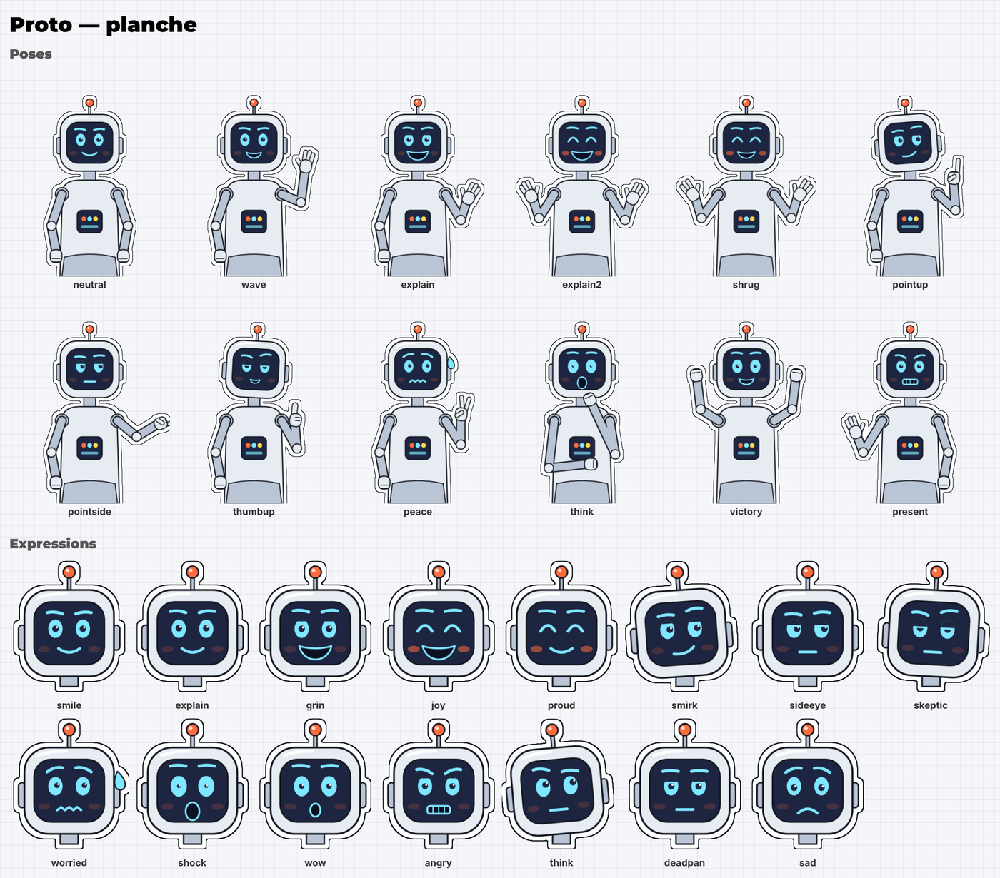

# Studio vidéo en code

Fabriquer des vidéos verticales (Reels, TikTok, Shorts) avec un **personnage mascotte**, entièrement **générées par du code** : voix de synthèse, animations, sous-titres, synchro labiale et montage. Pas de logiciel de montage, pas de service en ligne payant, pas de clé d'API : tout tourne sur ta machine.

<p align="center">
  
</p>



## Le principe

Une vidéo, c'est deux fichiers texte :

- **`story.json`** : ce que le personnage dit, découpé en phrases et en morceaux de légende ;
- **`scenes.json`** : ce qu'on voit à l'écran, calé sur ces phrases (titres, compteurs, listes, schémas, le personnage et ses expressions).

Le code fait le reste :



1. Une voix de synthèse **hors ligne** (Piper via sherpa-onnx) lit le texte ; on mesure l'instant de chaque phrase et le volume de la voix image par image.
2. Une page web dessine la vidéo à n'importe quel instant `t` (`window.renderAt(t)`), sans aucune animation « qui tourne toute seule » : chaque image est reproductible.
3. Le personnage, dessiné en SVG paramétrique, est pré-rendu en PNG ; sa bouche s'ouvre selon le volume de la voix.
4. Chromium capture les 30 images par seconde, FFmpeg les assemble avec la voix normalisée.
5. Whisper réécoute la voix pour repérer les mots mal prononcés, et une planche de contrôle montre chaque scène avant le rendu.

## Démarrage rapide

Il te faut Python 3.10 ou plus, FFmpeg, Node.js (seulement pour télécharger les polices) et environ 1 Go d'espace pour les modèles.

```bash
git clone https://github.com/<compte>/studio-video-code.git
cd studio-video-code
bash tools/setup_env.sh                                   # dépendances, Chromium, polices, voix, Whisper
python3 tools/make_video.py videos/demo-ciel-bleu all     # fabrique la vidéo de démonstration
```

Résultat dans `videos/demo-ciel-bleu/out/` : `video.mp4`, `video_social.mp4` (allégée, sans métadonnées) et `cover.jpg`.

## Ta première vidéo

```bash
python3 tools/make_video.py videos/ma-video new       # copie le modèle en 6 temps
# écris videos/ma-video/story.json puis scenes.json
python3 tools/make_video.py videos/ma-video prep      # voix, contrôle, page, images, planche
# regarde videos/ma-video/build/preview.jpg, corrige, relance « page » puis « preview »
python3 tools/make_video.py videos/ma-video render    # rendu final
```

## Ton propre personnage

Le personnage d'exemple, **Proto**, est dans [`character/character.js`](character/character.js). Remplace-le par le tien en gardant la même API (`render({ pose, expr, open, headOnly, props })`), puis vérifie-le sur sa planche :

```bash
python3 tools/character_sheet.py build/planche.png
```



## Documentation

| | |
|---|---|
| [1. Créer son personnage](docs/01-personnage.md) | concept, design, SVG paramétrique, expressions, poses, contour sticker, synchro labiale, fiche personnage |
| [2. Écrire une vidéo](docs/02-ecrire-une-video.md) | format de `story.json` et `scenes.json`, tous les éléments, zones sûres, éléments sur mesure |
| [3. Le pipeline](docs/03-pipeline.md) | chaque étape de fabrication en détail, dépannage |
| [4. Texte et légendes](docs/04-ecriture-et-legendes.md) | structure en 6 temps, vérification des faits, légendes qui ne sonnent pas « automatiques » |
| [5. Routine quotidienne](docs/05-routine-quotidienne.md) | file d'attente, réserve de vidéos, relecture, publication |
| [6. Avant de publier ton dépôt](docs/06-avant-de-publier.md) | audit de confidentialité (`tools/privacy_audit.py`) |

## Arborescence

```
character/character.js    le personnage (SVG paramétrique)
engine/                   moteur d'animation, éléments de scène, thème de couleurs, gabarit HTML
tools/                    fabrication (make_video.py), voix, contrôle, rendu, export, planche, audit
videos/_modele/           squelette d'une nouvelle vidéo
videos/demo-ciel-bleu/    vidéo de démonstration complète (avec un élément sur mesure)
pron.json                 corrections de prononciation
media/                    images de ce README
```

Créés par `setup_env.sh` ou pendant la fabrication, et non versionnés : `models/`, `fonts/`, `assets/character/`, `videos/*/build/`, `videos/*/out/`.

## Crédits et licences

- Code de ce dépôt : licence MIT (voir [LICENSE](LICENSE)).
- Synthèse et reconnaissance vocales : [sherpa-onnx](https://github.com/k2-fsa/sherpa-onnx) (Apache-2.0), voix [Piper](https://github.com/rhasspy/piper), modèle Whisper. **Chaque modèle de voix a sa propre licence** : lis sa fiche avant un usage commercial.
- Polices Montserrat, Inter et JetBrains Mono : SIL Open Font License, téléchargées via [Fontsource](https://fontsource.org).
- Rendu : [Playwright](https://playwright.dev) / Chromium, [FFmpeg](https://ffmpeg.org).
