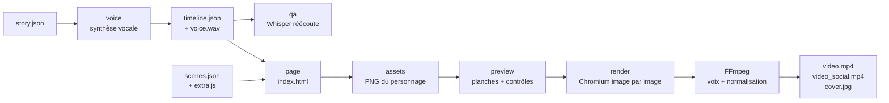

# 3. Le pipeline de fabrication



Chaque étape se lance séparément, ce qui permet de corriger et de relancer seulement ce qui a changé :

```bash
python3 tools/make_video.py videos/<v> voice     # 1. voix + timeline
python3 tools/make_video.py videos/<v> qa        # 2. contrôle de prononciation
python3 tools/make_video.py videos/<v> page      # 3. page HTML de la vidéo
python3 tools/make_video.py videos/<v> assets    # 4. images du personnage manquantes
python3 tools/make_video.py videos/<v> preview   # 5. planches de contrôle
python3 tools/make_video.py videos/<v> render    # 6. rendu final
# raccourcis : prep = étapes 1 à 5, all = tout
```

---

## 1. `voice` — la voix et la timeline

- Le texte de chaque phrase est **normalisé** : nombres en lettres, unités (`%`, `km`, `€`…), puis les règles de `pron.json` (expressions régulières → écriture phonétique, par exemple `GitHub` → « Gitt Hub »).
- La voix est produite **hors ligne** avec un modèle Piper (VITS) via [sherpa-onnx](https://github.com/k2-fsa/sherpa-onnx). Pas de service en ligne, pas de clé d'API, gratuit.
- Les silences de début et de fin de chaque phrase sont coupés, puis on ajoute une pause fixe (0,3 s après un point).
- **Timeline** : pour chaque phrase, son instant de début et de fin ; pour chaque chunk, une répartition au prorata du nombre de caractères prononcés. C'est approximatif, mais largement suffisant pour faire apparaître des légendes et des éléments au bon moment.
- **Enveloppe** : le volume de la voix image par image (RMS normalisé). Le moteur s'en sert pour ouvrir ou fermer la bouche du personnage.

Options : `--voice siwis` (voir `VOICES` dans `tools/voice.py`), `--speed 1.05`.

## 2. `qa` — le contrôle de prononciation

Un modèle Whisper réécoute chaque phrase et compare la transcription au texte prévu. Sous 0,85 de similarité, la phrase est signalée :

```
! P3 0.73 | dit : Ces molécules dévient surtout… || entendu : C'est mal éculé, dévissez…
```

Que faire : écouter la phrase, puis soit ajouter une règle dans `pron.json`, soit reformuler (souvent plus simple : un verbe en « -ient » ou un nom étranger mal lu se contourne facilement). Whisper se trompe lui aussi sur les noms propres rares : une alerte est un **signal**, pas une vérité.

## 3. `page` — la page HTML

`engine/template.html` est complété avec la timeline, le personnage, le moteur (`engine/engine.js`), la bibliothèque d'éléments (`engine/kit.js`, `engine/shapes.js`), ton `extra.js` et la description des scènes. Le résultat, `build/index.html`, s'ouvre dans un navigateur : ajoute `?t=12.5` à l'adresse pour voir l'image à 12,5 s.

Le principe central : **`window.renderAt(t)`** met la page dans l'état exact de l'instant `t`. Il n'y a aucune animation qui « tourne » toute seule. Chaque image est donc reproductible et peut être capturée dans n'importe quel ordre.

## 4. `assets` — les images du personnage

La page déclare la liste des variantes dont elle a besoin (`window.NEEDED`). Celles qui ne sont pas encore en cache sont rendues en PNG transparent dans `assets/character/`. Voir [01-personnage.md](01-personnage.md#étape-4--pré-rendre-en-png).

## 5. `preview` — les planches de contrôle

Deux images par scène (juste après son début, juste avant sa fin), assemblées dans `build/preview.jpg`. Le script signale aussi les éléments qui sortent de l'écran et les textes qui débordent de leur cadre.

**Regarde toujours la planche avant le rendu** : texte coupé, élément qui touche la tête du personnage ou les sous-titres, scène vide, apparition trop tôt ou trop tard. Pour regarder des instants précis en grand : `preview --times 12.3 40`.

## 6. `render` — le rendu final

1. Les images sont réparties entre plusieurs processus (`--workers 2` par défaut).
2. Chaque processus ouvre la page dans Chromium (Playwright) en 1080 × 1920, appelle `renderAt(i / 30)` pour chaque image `i`, fait une capture PNG et l'envoie à FFmpeg par un tube (x264, CRF 16).
3. Les morceaux sont recollés sans réencodage.
4. `tools/mux.sh` ajoute la voix avec **normalisation du volume** (`loudnorm`, −16 LUFS, le niveau habituel des réseaux sociaux).
5. `tools/export_social.sh` produit `video_social.mp4`, une version allégée sous une taille cible (`--max-mb`, 9,3 Mo par défaut), en deux passes pour garder le maximum de qualité, **sans métadonnées**.
6. `cover.jpg` : une image de couverture (par défaut à la fin de la 2ᵉ phrase, sinon `cover --times 2.5`).

Compte environ **6 à 7 minutes** pour une vidéo de 65 s sur 2 cœurs. Le rendu peut tourner en arrière-plan pendant que tu écris la suivante.

## Dépannage

| Symptôme | Piste |
|---|---|
| `modèle de voix introuvable` | `bash tools/setup_env.sh <voix>` |
| Chromium introuvable | `python3 -m playwright install chromium`, ou `export CHROMIUM_PATH=/chemin/vers/chromium` |
| Polices de remplacement à l'écran | relance `setup_env.sh` (dossier `fonts/` vide) |
| `référence de temps invalide` / `phrase inexistante` | un `at` pointe vers une phrase qui n'existe pas (on compte à partir de 0) |
| Le personnage n'apparaît pas | relance `assets` après avoir changé une pose ou une expression |
| Bouche qui clignote | ajuste les seuils de `openAt()` dans `engine/engine.js` |
