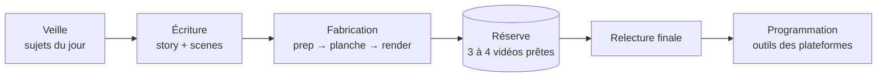

# 5. Tenir un rythme : la routine de production

Publier à un rythme soutenu n'est tenable que si la fabrication est séparée de la publication, avec une **réserve** de vidéos prêtes entre les deux.



## Un dossier par vidéo

```
videos/
  2026-01-15_ciel-bleu/
    story.json  scenes.json  extra.js  legende.txt
    build/      (fichiers intermédiaires, non versionnés)
    out/        video.mp4  video_social.mp4  cover.jpg
  journal.json
```

Préfixer par la date cible garde la file dans l'ordre.

## La file d'attente : `journal.json`

Un simple fichier suffit à savoir où en est chaque vidéo :

```json
{"videos": [
  {"id": "2026-01-15_ciel-bleu", "sujet": "Pourquoi le ciel est bleu", "statut": "pret",
   "date_cible": "2026-01-15", "sources": ["…", "…"]},
  {"id": "2026-01-15_autre-sujet", "statut": "publie", "publie_le": "2026-01-15"}
]}
```

Statuts : `brouillon` → `pret` → `publie`, plus `retenu` (en attente d'une vérification) et `perime` (sujet d'actualité qui n'a plus de sens). Une vidéo d'actualité qui dort trop longtemps dans la réserve passe en `perime` plutôt que d'être publiée en retard.

## La journée type

1. **Veille** (15 min) : un sujet ou deux, chacun vérifié sur deux sources (voir [04](04-ecriture-et-legendes.md)).
2. **Écriture** : `story.json` d'abord, à voix haute ; puis `scenes.json`.
3. **Fabrication** : `make_video.py prep`, lecture de la planche, corrections, puis `render` en arrière-plan.
4. **Légende** : `legende.txt`, au moment où le sujet est encore frais dans la tête.
5. **Réserve** : on vise 3 ou 4 vidéos prêtes d'avance. Les jours sans inspiration, on puise dedans.

## Avant de publier : la relecture finale

- [ ] La vidéo s'écoute en entier, avec le son, sur un téléphone.
- [ ] Aucun texte n'est caché par l'interface (zones sûres).
- [ ] Les chiffres et les noms à l'écran correspondent à la voix.
- [ ] Les faits sont toujours vrais aujourd'hui (une actualité évolue vite).
- [ ] La légende contient ses sources.

## Publier

Utilise les outils de programmation officiels de chaque plateforme (les studios web ou applications de création des réseaux). Ils gardent la qualité de la vidéo, gèrent les couvertures, les étiquettes et les horaires.

Tu peux confier la fabrication et la mise en file à un agent ou à une tâche planifiée (le pipeline se pilote entièrement en ligne de commande), mais garde une **relecture humaine** avant chaque publication. N'automatise pas les interactions (mentions j'aime, abonnements, commentaires) : c'est contraire aux règles des plateformes et c'est le meilleur moyen de voir un compte restreint.
